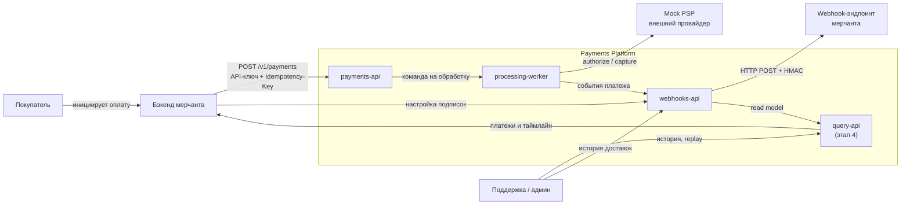
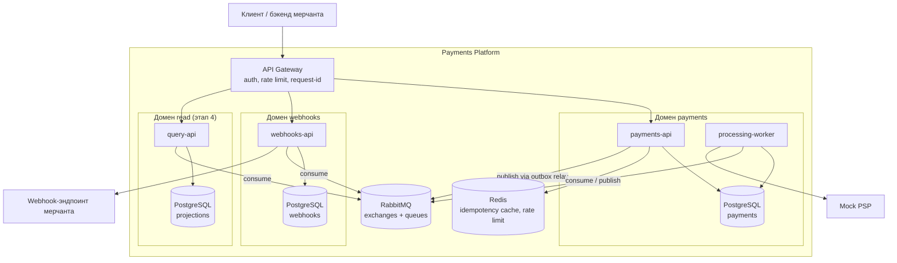
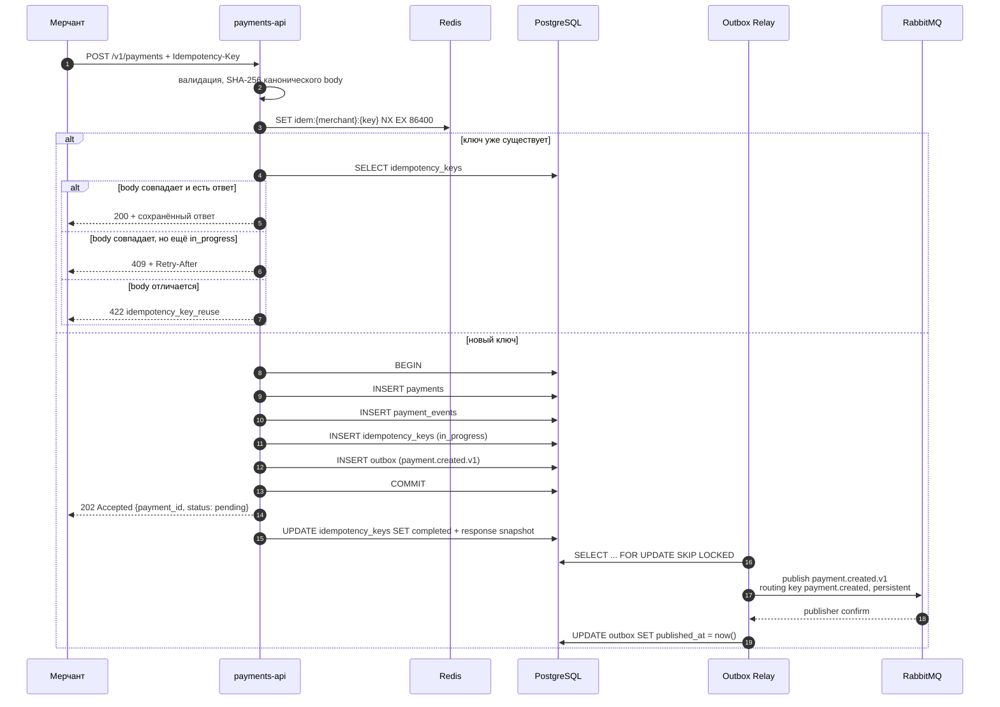
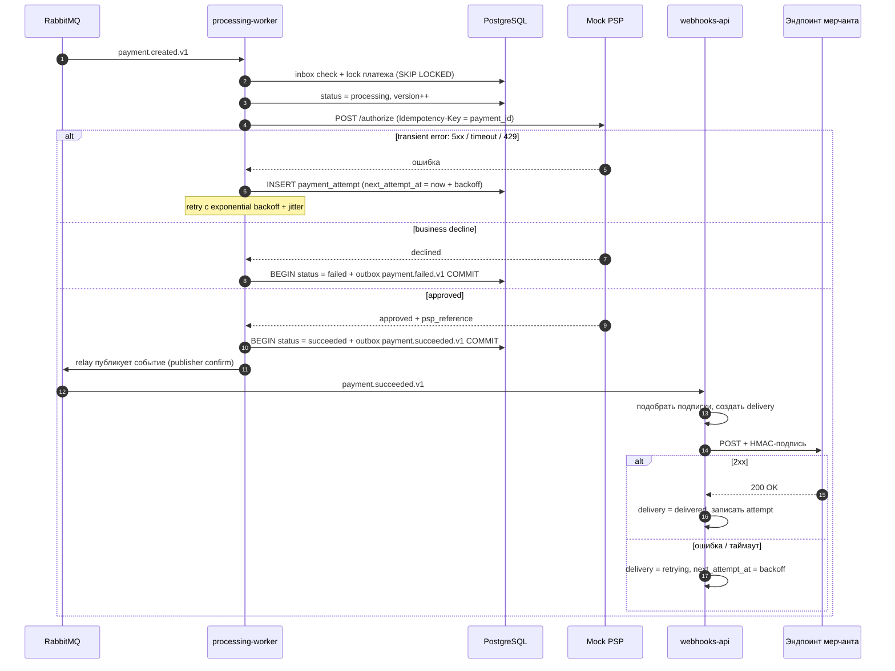
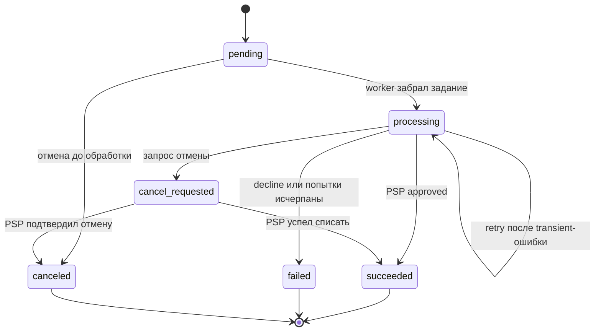
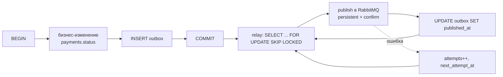
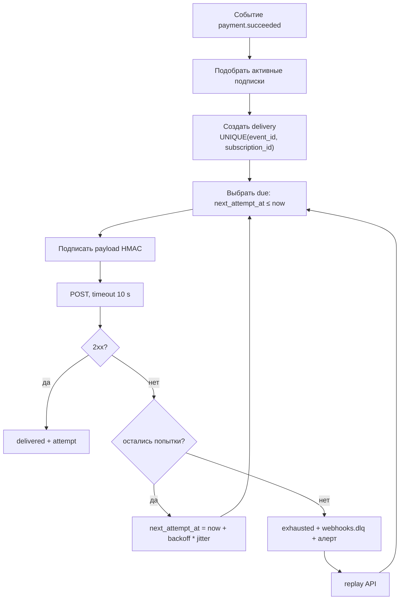
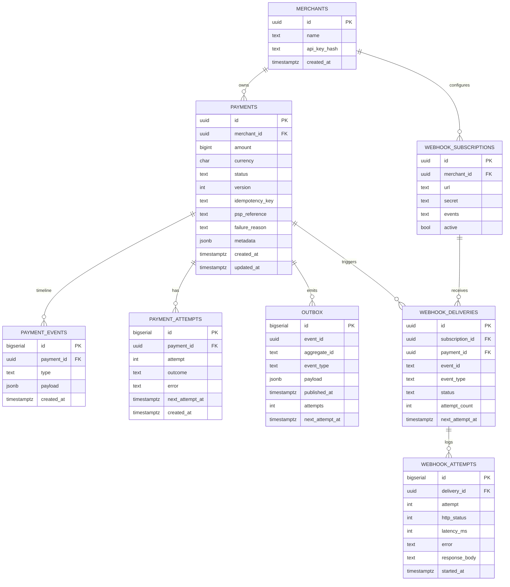
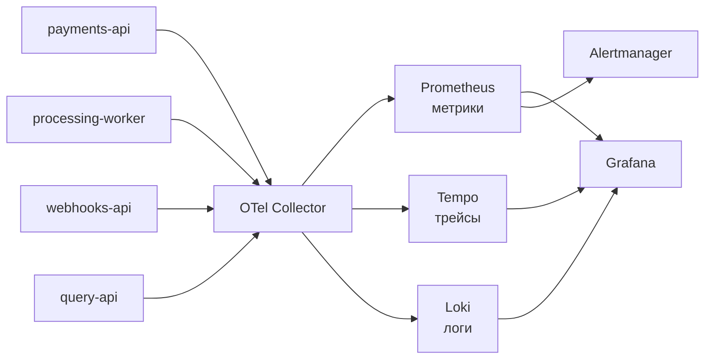

# Payments Platform — техническое задание (v0.1)

> Учебный, но приближённый к продакшену платёжный сервис: идемпотентные операции, асинхронная обработка через worker, transactional outbox, retry/backoff и полноценная история webhook-доставки.
>
> Цель — не «сделать ещё один CRUD», а руками потрогать распределённые компромиссы: at-least-once, идемпотентность, двойную запись, backoff, DLQ, наблюдаемость и отказоустойчивость.

---

## 0. TL;DR

| | |
|---|---|
| **Что** | Платёжный сервис для мерчантов: создание платежа, асинхронная обработка через mock-PSP, доставка webhook-событий с ретраями и историей |
| **Из чего** | `payments-api`, `processing-worker`, `webhooks-api` (+ опционально `query-api`) |
| **Инфраструктура** | PostgreSQL, Redis, RabbitMQ, OTel Collector, Prometheus, Grafana, Tempo, Loki |
| **Ключевые паттерны** | Idempotency-Key, transactional outbox, consumer inbox (dedupe), retry/backoff + jitter, DLQ, CQRS-lite |
| **Стек (базовый)** | .NET / ASP.NET Core, EF Core + Npgsql, RabbitMQ.Client, StackExchange.Redis, OpenTelemetry |
| **Формат запуска** | Docker Compose, один репозиторий (monorepo) |

---

## 1. Цели и не-цели

### 1.1. Цели

1. Реализовать полный жизненный цикл платежа: `pending → processing → succeeded / failed / canceled`.
2. Гарантировать, что повторный HTTP-запрос с тем же `Idempotency-Key` не создаёт второй платёж и не списывает деньги дважды.
3. Развязать приём платежа и его обработку: API отвечает быстро, PSP вызывается асинхронно.
4. Не терять события при падении сервиса или брокера — через transactional outbox.
5. Доставлять webhook-события мерчанту с retry/backoff, хранить каждую попытку и уметь переотправлять вручную.
6. Собрать наблюдаемость: метрики, логи, трейсы, дашборды и алерты по всем ключевым потокам.
7. Показать осознанные компромиссы: где at-least-once, где eventual consistency, где сознательно общий DB.

### 1.2. Не-цели (v1)

- Реальные деньги и реальный PSP (используем mock-провайдер с управляемыми сбоями).
- PCI DSS, хранение карточных данных, 3-D Secure «по-настоящему».
- Refund / partial refund / chargeback — вынесено в v2 (но модель данных к ним готова).
- Мультивалютные конвертации и курсы.
- Kubernetes, service mesh, мультирегион — сознательно за бортом, чтобы не утонуть.
- UI: максимум — Swagger UI, RabbitMQ Management UI и Grafana.

---

## 2. Что именно демонстрируем

Маппинг на строчку из резюме:

| Формулировка | Где живёт в проекте |
|---|---|
| «платёжный сервис» | `payments-api` + `processing-worker`, домен `payments` |
| «идемпотентные операции» | `Idempotency-Key` + таблица `idempotency_keys` + fast-path в Redis + PSP idempotency key |
| «processing worker» | отдельный consumer-сервис, state machine, вызов PSP, обработка таймаутов |
| «outbox-паттерн» | `outbox` таблица в одной транзакции с бизнес-изменением + relay → RabbitMQ |
| «retry/backoff» | классификация ошибок PSP, exponential backoff + jitter, `next_attempt_at`, DLQ |
| «история webhook-доставки» | `webhook_deliveries` + `webhook_attempts`, API истории, replay, подпись HMAC |

---

## 3. Роли и сценарии

**Акторы**

- **Мерчант** — создаёт платёж, настраивает webhook-эндпоинт, читает историю.
- **Покупатель** — инициирует оплату на стороне мерчанта (в проекте эмулируется).
- **PSP** — внешний провайдер (mock), авторизует/отклоняет платёж.
- **Поддержка/админ** — смотрит платежи, переотправляет webhook, читает аудит.

**Основные сценарии**

1. Мерчант создаёт платёж → получает `202 Accepted` и `payment_id`.
2. Worker обрабатывает платёж → PSP одобряет или отклоняет.
3. Мерчант получает webhook `payment.succeeded` / `payment.failed`.
4. Если эндпоинт мерчанта недоступен — платформа ретраит по расписанию.
5. Мерчант открывает историю доставки: сколько попыток, какие коды ответа, когда следующая.
6. Поддержка делает replay «застрявшей» доставки.
7. Повторный запрос создания с тем же ключом возвращает тот же результат.

---

## 4. Функциональные требования

### FR-1. Платежи

- `POST /v1/payments` — создать платёж. Обязателен заголовок `Idempotency-Key`.
- Поддержка суммы в minor units, валюты, `merchant_id`, `metadata`, `description`.
- `GET /v1/payments/{id}` — текущее состояние.
- `GET /v1/payments/{id}/events` — таймлайн событий платежа.
- `POST /v1/payments/{id}/cancel` — отмена, пока платёж не финализирован.
- Валидация: сумма > 0, валюта из allow-list, лимиты мерчанта.

### FR-2. Идемпотентность

- Один и тот же ключ + тот же body → тот же ответ (без нового платежа).
- Тот же ключ + другой body → `422 idempotency_key_reuse`.
- Параллельные запросы с одним ключом → один платёж, остальные получают `409` или ждут результат.
- Скоуп ключа — `(merchant_id, key)`.
- TTL ключа — 24 часа (настраиваемо).

### FR-3. Обработка

- Worker забирает задания из очереди, а не из HTTP-запроса.
- Вызов PSP идемпотентен: `Idempotency-Key` на стороне PSP стабилен между ретраями.
- Ретраи только для retryable-ошибок; бизнес-отказы (declined) не ретраятся.
- После исчерпания попыток — `failed` с причиной + событие + алерт.
- Отмена во время обработки переводит платёж в `cancel_requested` и пробует отменить у PSP.

### FR-4. Webhook

- CRUD подписок: URL, секрет, список событий, `active`.
- События: `payment.created`, `payment.processing`, `payment.succeeded`, `payment.failed`, `payment.canceled`.
- Каждая доставка имеет `delivery_id`, историю попыток и статус.
- Ретраи по расписанию с jitter; таймаут на попытку; после лимита — `exhausted` + DLQ.
- HMAC-подпись и timestamp; поддержка ротации секрета (два активных секрета).
- Ручной replay доставки (с аудитом).
- Опционально: автоотключение подписки после N подряд неудачных доставок.

### FR-5. История и чтение

- `GET /v1/webhook-deliveries?payment_id=&status=&from=&to=` — список доставок.
- `GET /v1/webhook-deliveries/{id}` — детали + попытки.
- `POST /v1/webhook-deliveries/{id}/replay` — переотправка.
- Пагинация курсорная, фильтры по статусу и времени.

### FR-6. Служебное

- Health/readiness endpoints, версия сборки.
- Метрики Prometheus, OTel-трейсы, структурные логи.
- Сид-скрипт: мерчант + подписка + API-ключ.
- Mock PSP с режимами: `ok`, `decline`, `timeout`, `5xx`, `slow`, `flaky`.

---

## 5. Нефункциональные требования

| Категория | Требование |
|---|---|
| latency API | p99 создания платежа < 250 ms (без учёта PSP) |
| throughput | 100 rps устойчиво в load-тесте, без роста ошибок |
| webhook | p95 первой попытки < 5 s после события; 99% доставок в течение 1 ч |
| доступность | 99.9% для API в рамках учебного стенда (SLO, а не SLA) |
| durability | событие не теряется при падении сервиса между коммитом и публикацией |
| durably | retry-состояние переживает рестарт (не в памяти) |
| consistency | API и worker — strongly consistent в своей БД; read-модель — eventual |
| ordering | at-least-once; строгий порядок не гарантируется, события несут `version` и `occurred_at` |
| security | API-ключи, HMAC, отсутствие карточных данных, секреты вне git |
| observability | каждый платёж прослеживается от HTTP до webhook по `trace_id` / `payment_id` |
| эксплуатация | один `docker compose up` поднимает весь стенд |

---

## 6. Архитектура

### 6.1. Контекст (C4 L1)



### 6.2. Контейнеры (C4 L2)



> `payments-api` и `processing-worker` — два деплоймента одного домена и одна БД. Это осознанный компромисс: не плодим распределённые транзакции там, где их можно избежать. Альтернатива — отдельный `payment-orchestrator` с API, но это лишний network hop и лишняя согласованность.

### 6.3. Границы сервисов

| Сервис | Ответственность | Владеет данными | Не делает |
|---|---|---|---|
| `payments-api` | приём платежей, идемпотентность, state machine, outbox | `payments`, `idempotency_keys`, `outbox`, `payment_events` | не вызывает PSP синхронно |
| `processing-worker` | consumer команд, вызов PSP, ретраи, финализация статуса | та же БД `payments` (осознанно) | не принимает внешний HTTP-трафик |
| `webhooks-api` | подписки, доставка, подпись, история, replay | `webhook_subscriptions`, `webhook_deliveries`, `webhook_attempts`, свой `inbox`/`outbox` | не знает, как создаётся платёж |
| `query-api` (этап 4) | read-модель для истории и таймлайна | `projections` | не пишет в доменные БД |
| `mock-psp` | эмуляция провайдера и сбоев | in-memory | не является частью продакшн-контура |

**Правила**

- Никаких cross-service JOIN и общих таблиц между доменами.
- Только события и (редко) синхронные API.
- Контракты версионируются: REST — OpenAPI, события — AsyncAPI + JSON Schema.
- Один сервис = один бинарник = один контейнер (кроме домена payments, см. выше).

### 6.4. Поток создания платежа



### 6.5. Поток обработки и webhook



### 6.6. Жизненный цикл платежа



Инварианты:

- Финальные статусы (`succeeded`, `failed`, `canceled`) не меняются, кроме refund в v2.
- Переходы только через optimistic locking по `version`.
- Каждый переход порождает запись в `payment_events` и событие в outbox — в одной транзакции.

---

## 7. Идемпотентность

### 7.1. Модель

Ключ идемпотентности — пара `(merchant_id, idempotency_key)`, а не просто ключ: разные мерчанты не должны мешать друг другу.

Храним:

| Поле | Назначение |
|---|---|
| `merchant_id`, `key` | PK |
| `request_hash` | SHA-256 от method + path + канонического JSON |
| `state` | `in_progress` / `completed` |
| `response_status`, `response_body` | снимок ответа для повторной выдачи |
| `payment_id` | связь с созданным платежом |
| `created_at`, `expires_at` | TTL и очистка |

### 7.2. Алгоритм

1. Валидируем `Idempotency-Key`: 8–255 символов, разрешённые символы.
2. Считаем `request_hash`.
3. Быстрый путь: Redis `SET NX` — если ключ уже «горячий», идём в Postgres за состоянием.
4. Медленный и надёжный путь: `INSERT ... ON CONFLICT DO NOTHING` в `idempotency_keys` **в той же транзакции**, что и платёж.
5. Если конфликт:
   - `request_hash` не совпал → `422`;
   - `completed` → отдаём сохранённый ответ;
   - `in_progress` → `409` с `Retry-After: 1` (клиент повторяет).
6. После коммита сохраняем снимок ответа и помечаем `completed`.

### 7.3. Почему и Redis, и Postgres

- Postgres — источник истины, переживает рестарт и падение Redis.
- Redis — быстрый отсев и защита от шторма одинаковых запросов.
- Если Redis лёг, сервис продолжает работать (degraded mode), просто медленнее.

### 7.4. Идемпотентность на стороне PSP

Ключ для PSP — стабильный `payment_id` (не `attempt_id`), иначе ретрай после таймаута создаст второе списание. Это классическая ловушка: таймаут не означает, что операция не прошла.

---

## 8. Transactional outbox

### 8.1. Схема



### 8.2. Таблица `outbox`

| Поле | Тип | Комментарий |
|---|---|---|
| `id` | bigserial | порядок вставки |
| `event_id` | uuid | ключ дедупликации для consumer'ов |
| `aggregate_type`, `aggregate_id` | text | `payment`, `pay_...` |
| `event_type`, `event_version` | text / int | `payment.succeeded`, 1 |
| `payload` | jsonb | тело события |
| `headers` | jsonb | `traceparent`, `correlation_id` |
| `status` | text | `pending` / `published` / `failed` |
| `created_at` | timestamptz | |
| `published_at` | timestamptz null | null = ещё не опубликовано |
| `attempts` | int | |
| `next_attempt_at` | timestamptz | backoff relay'я |
| `last_error` | text | |

Индекс: `(next_attempt_at, id) WHERE status = 'pending'`.

### 8.3. Relay

- Живёт библиотекой внутри сервиса, отдельный `BackgroundService`, poll каждые 200–500 ms.
- Батч до 100 событий, `FOR UPDATE SKIP LOCKED` — relay можно масштабировать горизонтально.
- Публикация: `persistent` + `mandatory=true` + publisher confirm. `published_at` ставим только после `BasicAck` от брокера.
- `BasicNack`, таймаут confirm или `BasicReturn` (нет очереди под routing key) — это ошибка публикации, а не успех.
- Заголовки AMQP: `event_id`, `event_type`, `traceparent` — для дедупликации и сквозного трейса.
- Ошибка → `attempts++`, `next_attempt_at = now + backoff`; после N попыток → `status = failed`, `next_attempt_at = NULL` и алерт.
- Публикация и коммит БД не атомарны — поэтому at-least-once, а не «ровно один раз».

### 8.4. Consumer inbox

Каждый consumer в той же транзакции, что и бизнес-изменение, вставляет `(consumer_name, event_id)` в `inbox` (`consumer_name` — имя сервиса/очереди, у RabbitMQ нет consumer groups). Повторная доставка упирается в PK и игнорируется. Это даёт **effectively-once** обработку при at-least-once доставке.

Альтернатива для взрослого продакшена — Debezium CDC по `outbox`; в учебном проекте poll-relay проще и нагляднее.

---

## 9. Processing worker и retry/backoff

### 9.1. Почему не sleep в обработчике

Долгие паузы (минуты/часы) нельзя держать в памяти: рестарт пода всё потеряет. Поэтому расписание хранится в БД (`payment_attempts.next_attempt_at`), а worker периодически выбирает созревшие попытки. Альтернативы: delayed-очереди RabbitMQ (TTL + DLX) или Redis sorted set — упомянуть в README, но не тащить в v1.

### 9.2. Классификация ошибок

| Тип | Примеры | Действие |
|---|---|---|
| retryable | timeout, 5xx, 429, connection reset | backoff и новая попытка |
| business | `card_declined`, `insufficient_funds` | сразу `failed`, без ретраев |
| fatal | `invalid_request`, `merchant_blocked` | `failed` + лог/алерт |

### 9.3. Расписание (processing)

| Попытка | Задержка |
|---|---|
| 1 | сразу |
| 2 | 1 s |
| 3 | 5 s |
| 4 | 30 s |
| 5 | 2 min |
| 6 | 10 min |
| 7 | 30 min |
| 8 | 2 h |

Далее — `failed` с `failure_reason = retries_exhausted`, событие и запись в очередь `payments.dlq` (через `payments.dlx`).

Jitter: `delay = base * (0.8 + rand*0.4)` — чтобы ретраи не собирались в стаю.

### 9.4. Защита от двойной обработки

- Одна команда на платёж: повторная доставка сообщения не означает повторный вызов PSP — сначала inbox-check и проверка статуса.
- Попытку берём через `SELECT ... FOR UPDATE SKIP LOCKED`, изменение статуса — через optimistic lock по `version`.
- Проверка «платёж уже в финальном статусе» перед вызовом PSP.
- Идемпотентный ключ PSP — последняя линия обороны.

### 9.5. Отмена

`cancel` не убивает уже летящий запрос в PSP. Платёж переходит в `cancel_requested`, worker после ответа PSP пытается выполнить void/cancel. Если PSP уже списал — остаётся `succeeded` и это явно видно в истории.

---

## 10. Webhook-доставка и история

### 10.1. Модель

- Подписка: `url`, `secret`, `events[]`, `active`, `description`.
- На каждое событие и каждую подходящую подписку создаётся `delivery` с `UNIQUE(event_id, subscription_id)`.
- `delivery` — это «намерение доставить», `attempt` — конкретная HTTP-попытка.
- Статусы delivery: `pending → delivering → delivered | retrying | exhausted | canceled`.

### 10.2. Подпись

```
X-Webhook-Id: whd_01J...
X-Webhook-Event-Id: evt_01J...
X-Webhook-Timestamp: 1763389945
X-Webhook-Attempt: 1
X-Webhook-Signature: v1=hex(hmac_sha256(secret, timestamp + "." + raw_body))
```

- Подпись считается по **сырому** телу, до повторной сериализации.
- Окно валидности timestamp — 5 минут (защита от replay).
- Ротация: два активных секрета, подпись двумя заголовками `v1=...,v1=...`.
- Секрет хранится зашифрованным (или хотя бы не в открытом виде в логах).

Пример payload:

```json
{
  "id": "evt_01JABCDEF",
  "type": "payment.succeeded",
  "version": 1,
  "occurred_at": "2026-11-17T14:32:25Z",
  "data": {
    "payment_id": "pay_01JXYZ",
    "merchant_id": "mer_01JQWE",
    "amount": 125000,
    "currency": "USD",
    "status": "succeeded",
    "psp_reference": "mock_abc123"
  }
}
```

### 10.3. Retry/backoff



| Попытка | Задержка |
|---|---|
| 1 | сразу |
| 2 | 10 s |
| 3 | 30 s |
| 4 | 2 min |
| 5 | 10 min |
| 6 | 1 h |
| 7 | 6 h |
| 8 | 24 h |

Итого ~31 час на доставку. Джиттер ±20%.

Дополнительно:

- Таймаут на попытку 10 s, общий бюджет — ограничен.
- Circuit breaker на эндпоинт: после серии ошибок временно не долбим.
- Ограничение параллелизма на мерчанта, чтобы не устроить шторм.
- `Retry-After` от мерчанта уважаем, если он больше нашего backoff.

### 10.4. История

`GET /v1/webhook-deliveries/{id}` отдаёт:

```json
{
  "id": "whd_01J...",
  "event_id": "evt_01J...",
  "event_type": "payment.succeeded",
  "payment_id": "pay_01J...",
  "status": "retrying",
  "attempts": [
    {
      "attempt": 1,
      "started_at": "2026-11-17T14:32:26Z",
      "finished_at": "2026-11-17T14:32:36Z",
      "http_status": 503,
      "latency_ms": 10012,
      "error": "upstream 503",
      "response_body": "..."
    }
  ],
  "next_attempt_at": "2026-11-17T14:32:46Z",
  "created_at": "2026-11-17T14:32:25Z"
}
```

- Тело ответа храним усечённым (например, 2 KB), чтобы не раздувать БД.
- Заголовки запроса — только безопасные, без секретов.
- Replay создаёт новую попытку с `attempt = max+1`, не переписывает историю.

### 10.5. Гарантии

- Доставка **at-least-once**: мерчант обязан дедуплицировать по `event_id`.
- Порядок не гарантируется: RabbitMQ не партиционирует по ключу, а ретраи могут обгонять друг друга. В payload есть `occurred_at` и `aggregate_version` — мерчант должен уметь дедуплицировать по `event_id` и игнорировать устаревшие версии.
- Событие считается доставленным только при 2xx.

---

## 11. Данные

### 11.1. Логическая ER-модель



> На диаграмме — логическая модель. Физически `payments` и `webhooks` живут в разных базах; связей-внешних-ключей между доменами нет, только идентификаторы.

### 11.2. Ключевые индексы

- `payments (merchant_id, created_at desc)`
- `payments (status) where status in ('pending','processing')`
- `outbox (published_at, next_attempt_at, id) where published_at is null`
- `payment_attempts (next_attempt_at) where outcome = 'retry_scheduled'`
- `webhook_deliveries (status, next_attempt_at) where status in ('pending','retrying')`
- `webhook_deliveries (payment_id)`
- `webhook_attempts (delivery_id, attempt)`

### 11.3. Retention

- `idempotency_keys` — 24 ч (job очистки).
- `outbox` — published старше 7 дней удаляем.
- `webhook_attempts` — 90 дней.
- `payments` — бессрочно (учебный проект).

---

## 12. API и события

### 12.1. REST (OpenAPI 3.1)

| Метод | Путь | Назначение |
|---|---|---|
| POST | `/v1/payments` | создать платёж |
| GET | `/v1/payments/{id}` | состояние |
| GET | `/v1/payments/{id}/events` | таймлайн |
| POST | `/v1/payments/{id}/cancel` | отмена |
| GET | `/v1/webhook-subscriptions` | список подписок |
| POST | `/v1/webhook-subscriptions` | создать |
| PATCH | `/v1/webhook-subscriptions/{id}` | изменить |
| DELETE | `/v1/webhook-subscriptions/{id}` | удалить |
| GET | `/v1/webhook-deliveries` | история доставок |
| GET | `/v1/webhook-deliveries/{id}` | детали + попытки |
| POST | `/v1/webhook-deliveries/{id}/replay` | переотправить |

Ошибки — единый формат:

```json
{
  "error": {
    "code": "idempotency_key_reuse",
    "message": "Idempotency-Key was reused with a different request body",
    "request_id": "req_01J..."
  }
}
```

### 12.2. События (AsyncAPI)

Конверт:

```json
{
  "event_id": "evt_01J...",
  "event_type": "payment.succeeded",
  "event_version": 1,
  "aggregate_version": 7,
  "occurred_at": "2026-11-17T14:32:25Z",
  "producer": "processing-worker",
  "aggregate_id": "pay_01J...",
  "correlation_id": "req_01J...",
  "causation_id": "evt_01J...",
  "trace_id": "4bf92f3577b34da6a3ce929d0e0e4736",
  "payload": {}
}
```

Exchanges и очереди:

| Exchange | Тип | Routing key | Очередь | Consumer |
|---|---|---|---|---|
| `payments.commands` | direct | `payment.created` | `payments.commands.q` | `processing-worker` |
| `payments.events` | topic | `payment.*` | `webhooks.payments.q` | `webhooks-api` |
| `payments.events` | topic | `payment.*` | `query.payments.q` | `query-api` (этап 4) |
| `payments.dlx` | fanout | — | `payments.dlq` | алертинг, ручной разбор |
| `webhooks.dlx` | fanout | — | `webhooks.dlq` | алертинг, ручной разбор |

- Очереди — quorum, durable; сообщения — persistent.
- `payments.commands.q` и `webhooks.payments.q` смотрят в свой DLX: poison-сообщение после `nack(requeue: false)` уходит в DLQ, а не крутится бесконечно.
- В `webhooks.dlq` также публикуем `exhausted`-доставки — чтобы операционный разбор шёл из одного места, даже если сама история лежит в БД.
- Routing key = тип события: `payment.created`, `payment.processing`, `payment.succeeded`, `payment.failed`, `payment.canceled`, `payment.cancel_requested`.
- RabbitMQ не хранит offset'ы и не даёт «переиграть» историю после ack. Роль журнала играют `payment_events` и `outbox` в БД, а повторная доставка webhook — это replay из `webhook_deliveries`, а не из брокера.
- Строгий порядок в рамках платежа не гарантируется. Если он понадобится, вариант — consistent-hash exchange по `payment_id`; в v1 сознательно не тащим.

---

## 13. Observability

### 13.1. Схема



### 13.2. Трейсы

- OTel SDK во всех сервисах, W3C `traceparent`.
- Проброс через HTTP-заголовки и через AMQP-заголовки сообщений (из outbox).
- Спаны: HTTP handler → DB query → outbox publish → consumer → PSP call → webhook POST.
- Атрибуты: `payment_id`, `merchant_id`, `event_id`, `delivery_id`, `attempt`.
- Один трейс должен позволять пройти путь «создание → PSP → webhook» (с оговоркой на асинхронность: связь через `link`, а не parent, если хочется канонично).

### 13.3. Метрики

| Метрика | Тип | Зачем |
|---|---|---|
| `http_server_duration_seconds` | histogram | RED по API |
| `payments_created_total{status}` | counter | воронка |
| `payment_processing_duration_seconds` | histogram | скорость обработки |
| `payment_attempts_total{outcome}` | counter | retry-активность |
| `outbox_pending_events` | gauge | неопубликованный хвост |
| `outbox_publish_lag_seconds` | histogram | задержка публикации |
| `queue_depth{queue}` | gauge | готовые к доставке сообщения (аналог lag) |
| `queue_unacked{queue}` | gauge | сообщения в работе, признак зависшего consumer'а |
| `webhook_delivery_attempts_total{outcome}` | counter | успех/провал |
| `webhook_delivery_latency_seconds` | histogram | скорость доставки |
| `webhook_retries_scheduled_total` | counter | штормы ретраев |
| `webhook_dlq_size` | gauge | «застрявшие» |
| `idempotency_cache_hits_total` | counter | эффективность Redis |

Метрики брокера отдаёт штатный плагин `rabbitmq_prometheus` (порт 15692) — отдельный exporter не нужен.

### 13.4. Логи

JSON, обязательные поля: `ts`, `level`, `service`, `trace_id`, `span_id`, `request_id`, `payment_id`, `merchant_id`, `event`, `duration_ms`, `error`.

Никаких PAN, CVV, полных тел запросов с PII. Секреты и подписи — маскировать.

### 13.5. Дашборды

1. **Service overview** — RPS, ошибки, p50/p95/p99 по каждому сервису.
2. **Payment funnel** — created → processing → succeeded/failed, конверсия, причины отказов.
3. **Outbox & consumers** — pending, queue depth, unacked, DLQ, скорость relay.
4. **Webhook health** — attempts, success rate, latency, retries, exhausted, top failing мерчанты.
5. **Infra** — Postgres connections/locks, Redis hits/memory, RabbitMQ queue depth/connections/memory.

### 13.6. Алерты

- `outbox_publish_lag_seconds > 60` в течение 5 минут.
- `queue_depth{queue}` > 1000 в течение 10 минут или `queue_unacked` не падает 15 минут.
- Доля неуспешных webhook-доставок > 20% за 10 минут.
- `webhook_dlq_size > 0`.
- p99 создания платежа > 1 s в течение 10 минут.
- 5xx rate > 1% в течение 5 минут.

---

## 14. Безопасность

- **API-ключи мерчанта**: `Authorization: Bearer sk_test_...`, в БД — хеш + префикс для поиска. Ротация.
- **Rate limit** на мерчанта и на IP (Redis token bucket).
- **Webhook HMAC** + timestamp, окно 5 минут, ротация секретов.
- **Идемпотентность** скоупится по мерчанту — нельзя «угадать» чужой ключ.
- **Никаких карточных данных**: только токены mock-PSP.
- **Секреты** — `.env` / docker secrets, `.env.example` в git, реальные значения — нет.
- **Аудит** replay и админских действий: кто, когда, что.
- **Валидация URL подписки**: только https (в проде — запрет внутренних IP, SSRF-защита).
- **Ограничение размера body** и таймауты на всех входящих запросах.

---

## 15. Технологический стек

Стек зафиксирован под ASP.NET Core. Архитектура от языка не зависит — меняются только адаптеры: HTTP-фреймворк, клиент БД, брокер и фоновые воркеры. Все паттерны из разделов 7–10 остаются теми же.

### 15.1. Базовый вариант

| Слой | Технология | Почему |
|---|---|---|
| Платформа | .NET 8+ (для проекта — 10 LTS), C# 12/13 | один язык для API, воркеров и тестов; ASP.NET Core — быстрый HTTP-стек |
| HTTP | ASP.NET Core Minimal APIs + endpoint filters | меньше церемоний, чем контроллеры; фильтр — удобное место для идемпотентности |
| Валидация | FluentValidation | декларативно и тестируемо |
| БД | PostgreSQL 16 | транзакции, `SKIP LOCKED`, `jsonb` |
| Доступ к данным | EF Core 9/10 + Npgsql | миграции и маппинг; сырой SQL — для очередей и `SKIP LOCKED` |
| Миграции | EF Core Migrations | один инструмент с моделью |
| Кэш/локи | Redis 7 + StackExchange.Redis | fast-path идемпотентности, rate limit |
| Брокер | RabbitMQ 4.x | лёгкий, DLX и publisher confirms из коробки, management UI; без партиций и offset'ов |
| Клиент брокера | RabbitMQ.Client 7.x | официальный асинхронный клиент: publisher confirms, manual ack, prefetch |
| HTTP-клиенты | `IHttpClientFactory` + Polly v8 | пулы соединений, таймауты, circuit breaker |
| Фоновая работа | `BackgroundService` + `PeriodicTimer` + `Channel<T>` | штатный хостинг, graceful shutdown, DI-скоупы |
| Контракты | OpenAPI 3.1 + AsyncAPI + JSON Schema | явные границы |
| Трейсы | OpenTelemetry .NET + Tempo | автоинструментация ASP.NET Core, HttpClient, Npgsql |
| Метрики | Prometheus + Grafana | стандарт |
| Логи | Serilog + Loki (или OTLP-логи) | структурные логи с TraceId/SpanId |
| E2E/нагрузка | compose + k6 | воспроизводимо |
| Тесты | xUnit + FluentAssertions + Testcontainers for .NET + `WebApplicationFactory` | интеграционные с реальными зависимостями |

### 15.2. Альтернативы и что не тащим в v1

| Вместо | Можно взять | Комментарий |
|---|---|---|
| Ручной outbox/inbox | MassTransit | готовые outbox/inbox и саги, но учебная механика спрятана; честный путь — сначала руками, потом сравнить |
| Ручной outbox/inbox | Wolverine | другой взгляд на консистентность и обработку сообщений |
| EF Core | Dapper | для outbox-релея и чтения прозрачнее и быстрее |
| Minimal API | Контроллеры | если ближе классический ASP.NET |
| RabbitMQ | NATS JetStream | ещё легче: один бинарник ~20 МБ, но другая модель очередей и DLQ нужно строить самому |
| RabbitMQ | Redis Streams | вообще без нового контейнера, но слабее гарантии доставки и нет DLX |
| RabbitMQ | Apache Kafka | если понадобятся партиции, replay и большие объёмы |
| poll-relay | Debezium CDC | «взрослее», но сложнее в отладке |
| Redis | Valkey | API-совместимый форк |
| Tempo | Jaeger | привычнее, но тяжелее |
| Compose | k3s + Helm | следующий шаг после v1, не в первом инкременте |

> MassTransit/Wolverine стоит попробовать **после** ручной реализации: иначе outbox и retry останутся «магией фреймворка», а на собеседовании нужно объяснять механику, а не конфиг.

### 15.3. .NET-специфика, на которой легко обжечься

- **`DbContext` — scoped.** В `BackgroundService` создавай scope на сообщение через `IServiceScopeFactory`: один долгоживущий контекст = гонки и `ObjectDisposedException`.
- **Не `Task.Run` для фоновой работы.** `BackgroundService` + `CancellationToken` + корректный shutdown, иначе релей будет терять батчи при деплое.
- **Идемпотентность — через unique constraint.** Лови `DbUpdateException` с `PostgresException.SqlState == "23505"`, а не делай `SELECT` перед `INSERT` (TOCTOU).
- **`FOR UPDATE SKIP LOCKED` — только сырой SQL.** `FromSqlRaw`/Dapper; LINQ этого не умеет.
- **Outbox пишется в той же транзакции**, что и бизнес-изменение: `IDbContextTransaction` + один `SaveChangesAsync`.
- **Время — через `TimeProvider`.** Иначе тесты ретраев превращаются в `Thread.Sleep`.
- **`jsonb`** — `JsonDocument`/`JsonElement` или value converters; не `string` с ручной сериализацией.
- **OTel-контекст в AMQP** надо inject/extract вручную (`Propagators.DefaultTextMapPropagator`): автоинструментация покрывает HTTP, но не сообщения.
- **Publisher confirms обязательны.** `BasicPublishAsync` без ожидания `BasicAck` — это fire-and-forget, при котором outbox пометит событие опубликованным, хотя брокер его не принял.
- **`HttpClient` — только из `IHttpClientFactory`**, не `new` на каждую доставку.
- **Polly — для коротких ретраев** (сеть, 5xx в рамках попытки). Долгие паузы живут в БД, а не в Polly.
- **`System.Text.Json`**: зафиксировать `JsonSerializerOptions` (camelCase, enum как string), source generators — для контрактов.
- **Секреты в логах**: Serilog destructuring + маскирование, иначе webhook-подпись утечёт в Loki.

---

## 16. Структура репозитория

```
.
├── PaymentsPlatform.sln
├── Directory.Build.props        # общие настройки сборки, nullable, warnings-as-errors
├── Directory.Packages.props     # central package management
├── compose.yaml
├── Makefile
├── .env.example
├── api/
│   ├── openapi.yaml
│   └── asyncapi.yaml
├── contracts/
│   └── events/
│       ├── payment.created.v1.json
│       ├── payment.succeeded.v1.json
│       └── ...
├── src/
│   ├── Payments.Api/            # Minimal API, идемпотентность, state machine
│   │   ├── Endpoints/
│   │   ├── Domain/
│   │   ├── Data/
│   │   └── Migrations/
│   ├── Payments.Worker/         # consumer, вызов PSP, retry
│   ├── Webhooks.Api/            # подписки, доставка, история, replay
│   ├── Query.Api/               # этап 4
│   ├── MockPsp/
│   ├── Payments.Contracts/      # DTO и события, без логики
│   └── Shared/
│       ├── Shared.Outbox/
│       ├── Shared.Inbox/
│       ├── Shared.Idempotency/
│       ├── Shared.Backoff/
│       ├── Shared.WebhookSigning/
│       ├── Shared.Observability/
│       └── Shared.Messaging/
├── deploy/
│   ├── grafana/
│   ├── prometheus/
│   ├── otel/
│   └── rabbitmq/
├── scripts/
│   ├── seed.sh
│   └── demo.sh
└── tests/
    ├── Payments.UnitTests/
    ├── Payments.IntegrationTests/
    ├── Webhooks.IntegrationTests/
    ├── e2e/
    └── load/
```

Правила: сервисы ссылаются только на `Payments.Contracts` и `Shared.*`, но не друг на друга. `Shared.*` — тонкие библиотеки без бизнес-логики, иначе получится распределённый монолит на общих классах. Внутри проектов — `internal`-классы по умолчанию, `public` только там, где это реально контракт.

---

## 17. Локальный запуск

```bash
cp .env.example .env

# весь стенд
docker compose up -d --build
./scripts/seed.sh                      # мерчант, API-ключ, webhook-подписка

# локальная разработка
dotnet build
dotnet test
dotnet run --project src/Payments.Api
dotnet run --project src/Payments.Worker

# миграции
dotnet ef migrations add Initial --project src/Payments.Api
dotnet ef database update --project src/Payments.Api

open http://localhost:8080/swagger      # Swagger UI
open http://localhost:15672             # RabbitMQ Management (guest/guest)
open http://localhost:3000              # Grafana
```

Compose поднимает:

`postgres`, `redis`, `rabbitmq` (management), `otel-collector`, `prometheus`, `tempo`, `loki`, `grafana`, `payments-api`, `processing-worker`, `webhooks-api`, `mock-psp`, `webhook-sink` (эндпоинт-приёмник для демо, умеет падать по команде).

Демо-сценарий:

```bash
# успешный платёж
curl -X POST localhost:8080/v1/payments \
  -H 'Authorization: Bearer sk_test_demo' \
  -H 'Idempotency-Key: demo-1' \
  -H 'Content-Type: application/json' \
  -d '{"amount":125000,"currency":"USD","description":"demo"}'

# повтор — тот же ответ, второй платёж не создаётся
# сломать webhook-приёмник и посмотреть ретраи в истории
```

---

## 18. Тестирование и chaos-сценарии

### 18.1. Уровни

- **Unit** (xUnit): state machine, расчёт backoff через `TimeProvider`, канонизация body, HMAC.
- **Integration** (Testcontainers for .NET + `WebApplicationFactory`): Postgres/Redis/RabbitMQ; outbox relay, inbox dedupe, publisher confirms.
- **Contract**: валидация ответов по OpenAPI, событий по JSON Schema.
- **E2E**: compose, полный путь create → PSP → webhook.
- **Load**: k6, 100 rps, проверка p99 и отсутствия дублей.

### 18.2. Обязательные сценарии

| # | Сценарий | Ожидание |
|---|---|---|
| 1 | Два одинаковых запроса с одним `Idempotency-Key` | один платёж, одинаковый ответ |
| 2 | Тот же ключ, другой body | `422` |
| 3 | 10 параллельных запросов с одним ключом | один платёж, остальные `409`/тот же ответ |
| 4 | PSP ответил таймаутом, но списал | ретрай не создаёт второе списание (PSP idempotency) |
| 5 | Worker упал после коммита, до публикации | событие публикуется после рестарта |
| 6 | RabbitMQ недоступна 2 минуты | outbox копится, затем разгребается, queue depth виден на дашборде |
| 7 | Redis недоступен | сервис работает, идемпотентность через Postgres |
| 8 | Дубликат сообщения из RabbitMQ (redelivery после nack) | inbox не даёт обработать дважды |
| 9 | Webhook вернул 500 | ретраи по расписанию, история попыток полная |
| 10 | Webhook недоступен 31 час | `exhausted` + DLQ + алерт, replay работает |
| 11 | Мерчант вернул 429 с `Retry-After` | задержка не меньше указанной |
| 12 | Отмена во время обработки | `cancel_requested` → `canceled` или `succeeded` с объяснением |

### 18.3. Definition of Done

- [ ] Все сценарии выше проходят в e2e.
- [ ] Есть дашборд, на котором видно платёж и его webhook-доставку.
- [ ] По `payment_id` можно найти логи, трейс и все попытки доставки.
- [ ] Ни один сценарий не приводит к двойному списанию.
- [ ] README содержит архитектуру, API и инструкцию запуска.

---

## 19. Roadmap

| Этап | Что делаем | Чему учимся |
|---|---|---|
| **0. Каркас** | compose, Postgres, миграции, health, OTel, CI | инфраструктура как код, базовый DX |
| **1. Платежи** | `payments-api`, идемпотентность, outbox, relay | транзакции, идемпотентность, dual-write |
| **2. Worker** | consumer, state machine, mock PSP, retry/backoff | at-least-once, идемпотентный consumer, backoff |
| **3. Webhook** | подписки, доставка, HMAC, история, replay | retry-штормы, DLQ, подпись, наблюдаемость |
| **4. Read-модель** | `query-api`, проекции, таймлайн | CQRS-lite, eventual consistency |
| **5. Надёжность** | chaos-тесты, load-тест, алерты, SLO | устойчивость, диагностика |
| **6. Плюшки** | refund, ротация секретов, rate limit, админка | продакшн-детали |

Этапы 0–3 — обязательный минимум, закрывающий строчку из резюме. 4–6 — то, что отличает учебный проект от «ещё одного pet project».

---

## 20. Риски и компромиссы

| Риск / решение | Комментарий |
|---|---|
| Двойная запись (БД + брокер) | решается outbox; публикация at-least-once, consumer дедуплицирует |
| «Exactly-once» | честно: at-least-once + идемпотентность = effectively-once |
| Общая БД у api и worker | осознанно, чтобы не строить распределённые транзакции; границы домена соблюдены |
| Ретраи создают нагрузку | jitter, circuit breaker, лимит параллелизма, `Retry-After` |
| Порядок событий | не гарантируется: RabbitMQ без партиций; события несут `aggregate_version`, потребитель идемпотентен |
| Replay событий | RabbitMQ не хранит историю после ack; источник истины — `payment_events` и `outbox`, а не брокер |
| Рост outbox | retention + мониторинг лага + алерт |
| Eventual consistency read-модели | явно документируем, отдаём `as_of` / `stale` флаг |
| Секреты в webhook | шифрование at rest, маскирование в логах, ротация |
| Утечка PII в логи | явный allow-list полей, ревью логов |

---

## 21. Открытые вопросы

1. **Версия .NET** — 8 LTS (если так на работе) или 10 LTS для проекта?
2. **Outbox руками или через MassTransit/Wolverine** — делаем механику сами ради обучения или берём готовую библиотеку?
3. **PSP** — только mock или ещё интеграция с тестовым контуром реального провайдера?
4. **Аутентификация** — API-ключи или JWT/OAuth2 client credentials?
5. **Мультивалютность** — фиксируем USD/EUR или нужна модель с курсами?
6. **Refund** — закладываем в v1 или v2?
7. **Деплой** — только compose или сразу k3s/Helm как отдельная ветка обучения?
8. **UI** — нужен ли минимальный дашборд мерчанта или хватит Swagger + Grafana?

---

## Приложение A. Почему такие решения

**Почему outbox, а не «просто publish в handler»**
Публикация в брокер не участвует в транзакции БД. Между коммитом и publish процесс может умереть — событие потеряно. Outbox делает запись события частью бизнес-транзакции, а relay догоняет.

**Почему `SKIP LOCKED`**
Позволяет нескольким relay/worker'ам разбирать очередь без блокировок и без дублей — конкуренция на строках вместо распределённого лока.

**Почему RabbitMQ, а не Kafka**
Kafka/Redpanda сильны там, где нужны партиции, retention на дни и replay истории. В этом сервисе брокер — только транспорт: ретраи живут в БД, история — в `payment_events`, строгий порядок не нужен. RabbitMQ даёт quorum-очереди, DLX, publisher confirms и management UI при заметно меньшем потреблении памяти и без отдельного Kafka-контура. Если проект вырастет до event sourcing с replay — Kafka вернётся.

**Почему не NATS JetStream и не Redis Streams**
NATS ещё легче, но DLQ и подтверждения consumer'а придётся строить руками, а .NET-примеров меньше. Redis Streams соблазняют «ноль новых контейнеров», но превращают кэш в место хранения денежных событий — граница ответственности размывается. Для учебного проекта важнее предсказуемость и документация, чем минус 100 МБ RAM.

**Почему backoff с джиттером**
Без джиттера все ретраи приходят одновременно и добивают уже лежащий сервис. Джиттер размазывает нагрузку.

**Почему история попыток, а не только финальный статус**
При разборе инцидента нужен ответ «что именно мы отправили и что нам ответили», а не «доставлено/не доставлено». Это также основа для replay и для доверия мерчанта.

**Почему Redis не источник истины**
Кэш можно потерять. Идемпотентность и деньги — только Postgres; Redis — ускоритель.
